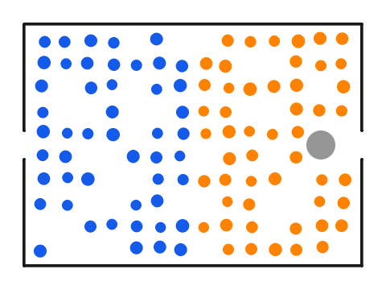
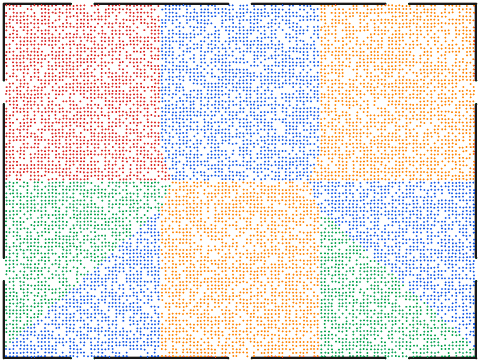
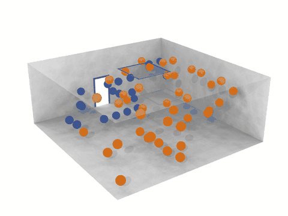

# ParticleGym

**Physics-based particle simulations as fast reinforcement-learning environments, in 2D and 3D.**

[](https://github.com/ZhaojieC/particlegym/actions/workflows/ci.yml)
[](LICENSE)

<table>
  <tr>
    <td width="33%"></td>
    <td width="33%"></td>
    <td width="33%"></td>
  </tr>
  <tr>
    <td align="center">100 pedestrians leave a room; a pillar stands in front of the right door</td>
    <td align="center">10,000 pedestrians leave a hall through ten doors</td>
    <td align="center">Two groups walk in opposite directions and form lanes</td>
  </tr>
  <tr>
    <td width="33%"></td>
    <td width="33%"></td>
    <td width="33%"></td>
  </tr>
  <tr>
    <td align="center">An arcade game: the ball moves by Newton's equations</td>
    <td align="center">Billiards with friction and inelastic collisions</td>
    <td align="center">A shepherd (red) drives a flock to the target</td>
  </tr>
  <tr>
    <td width="33%"></td>
    <td width="33%"></td>
    <td width="33%"></td>
  </tr>
  <tr>
    <td align="center">Microswimmers in a field of vortices</td>
    <td align="center">Cells migrate together along a chemical signal</td>
    <td align="center">Two fluids separate (dissipative particle dynamics)</td>
  </tr>
  <tr>
    <td width="33%"></td>
    <td width="33%"></td>
    <td width="33%"></td>
  </tr>
  <tr>
    <td align="center">60 agents leave a 3D chamber through a door and a ceiling hatch</td>
    <td align="center">8 drones encircle a moving target (<a href="https://github.com/ZhaojieC/drone-encircle">drone-encircle</a>, built on ParticleGym)</td>
    <td align="center"></td>
  </tr>
</table>

Every animation is a simulation with ParticleGym, made by a script in
[`examples/gallery`](examples/gallery). The players, the shepherd, the
swimmers and the cells follow simple scripted rules here; trained policies
come next.

> **Status: pre-alpha (v0.1.0.dev0).** The physics core, its validation
> tests, a room-evacuation environment, six
> [experimental environments](docs/experimental.md), Gymnasium and PettingZoo
> wrappers and two [learning baselines](docs/learning.md) are in place. APIs
> may change. See the [roadmap](docs/roadmap.md).

ParticleGym simulates many interacting particles (pedestrians, active
colloids, cells, swarm robots) and lets reinforcement-learning agents control
some of them. It is built around three goals:

- **Physically consistent.** Agents choose what they *want* (a desired
  direction of motion); the motion itself always follows from forces and a
  proper integrator. Conservative forces are derived from energies by automatic
  differentiation, and every physical claim is checked by an automated test.
- **Fast.** Everything is written in [JAX](https://github.com/jax-ml/jax): one
  simulation step compiles to a single XLA program that runs on CPU or GPU, and
  environments can be batched with `jax.vmap`. On a 4-core CPU a step of a
  100-pedestrian crowd takes about 0.15 ms (see the
  [benchmarks](docs/roadmap.md#performance-plan)).
- **Simple.** Pure Python, two dependencies (`jax`, `numpy`), the same code for
  2D and 3D, and readable models with references.

## Quick start

```bash
git clone https://github.com/ZhaojieC/particlegym
cd particlegym
pip install -e ".[viz]"
```

ParticleGym requires Python 3.12 or later. For GPU support, install the
matching JAX build first, following the
[JAX installation guide](https://docs.jax.dev/en/latest/installation.html).

```python
import jax

from particlegym import envs, viz
from particlegym import physics as pp

# A 10 m x 10 m room with a door in the right wall and 30 pedestrians.
env = envs.Evacuation(room=(10.0, 10.0), exits=[pp.Opening("x+", (4.4, 5.6))], n_agents=30)
step = jax.jit(env.step)

key = jax.random.key(0)
obs, state = env.reset(key)
frames = [env.render(state)]
for _ in range(100):  # 10 s
    key, action_key, step_key = jax.random.split(key, 3)
    action = jax.random.randint(action_key, (env.n_agents,), 0, 8)  # a random direction each
    obs, state, reward, terminated, truncated, info = step(step_key, state, action)
    frames.append(env.render(state))
viz.save_gif("room.gif", frames)

# The same environment, 1024 rooms at once.
keys = jax.random.split(key, 1024)
obs, states = jax.vmap(env.reset)(keys)
actions = jax.random.randint(key, (1024, env.n_agents), 0, 8)
obs, states, reward, *_ = jax.jit(jax.vmap(env.step))(keys, states, actions)
print(obs.shape, reward.shape)  # (1024, 30, 4) (1024, 30)
```

An action sets the direction in which an agent wants to walk. The driving
term of the social force model, `m (v0 e - v) / tau`, is exactly the friction
term of Langevin dynamics with `gamma = 1 / tau` and drift velocity
`u = v0 e`, so one integrator serves pedestrians, colloids and active
particles; see [Physics models](docs/physics.md). The physics core can also be
used directly, without an environment: see
[`examples/room_evacuation_2d.py`](examples/room_evacuation_2d.py) and the
other [examples](examples).

## Features

| Component | Available |
|---|---|
| Environments (preview) | functional `Evacuation` room environment in 2D and 3D: `reset`/`step` with `jit` and `vmap`, discrete or continuous desired directions, crowd policies ([docs](docs/environments.md)) |
| Environments (experimental) | `CounterFlow`, `BrickWall` (state or pixel observations), `Billiards`, `Herding`, `Microswimmer`, `CellMigration`: tested mechanics and scripted policies, not yet compared with measurements ([docs](docs/experimental.md)) |
| Wrappers | Gymnasium (single and vector environments, registered ids) and PettingZoo (parallel interface) ([docs](docs/learning.md)) |
| Baselines | PPO with a shared policy and tabular Q-learning in pure JAX, several seeds in one compiled program ([docs](docs/learning.md)) |
| Domain | 2D or 3D box, periodic or open along each axis |
| Neighbour search | brute force; cell list with overflow detection |
| Pair interactions | harmonic, WCA, social force (Helbing et al. 2000), tangential friction |
| Geometry | plates (segments/rectangles), spheres, boxes, rooms with real door openings |
| Integrators | velocity Verlet; BAOAB Langevin with a drift velocity (self-propulsion); Brownian dynamics |
| Exits | `alive` mask: particles that leave are frozen, shapes stay static |
| Output | pictures, GIF and MP4 animations of 2D systems (`particlegym.viz`); pixel images for observations; extended XYZ for [OVITO](https://www.ovito.org/) and ASE |

## Validation

The test suite checks, among others: energy conservation with the expected
`dt^2` scaling, momentum conservation, forces equal to minus the energy
gradient, cell list against brute force, the Langevin temperature, the
Einstein diffusion law against the exact Ornstein-Uhlenbeck result, the
published social-force law, and that pedestrians leave a room only through
the door. See [Validation](docs/validation.md).

```bash
pip install -e ".[test]"
pytest
```

## Background

ParticleGym grows out of the particle-dynamics environment used in

> Y. Zhang, Z. Chai, G. Lykotrafitis. *Deep reinforcement learning with a
> particle dynamics environment applied to emergency evacuation of a room with
> obstacles.* Physica A 571, 125845 (2021).
> [doi:10.1016/j.physa.2021.125845](https://doi.org/10.1016/j.physa.2021.125845)

It generalises that environment to 3D, to other particle systems, and to
modern, fast, tested software.

## Contributing and citing

Contributions are welcome; see [CONTRIBUTING.md](CONTRIBUTING.md). Citation
metadata is in [CITATION.cff](CITATION.cff). ParticleGym is released under
the [MIT license](LICENSE).
