# Experimental environments

These environments show what the physics core can do beyond room evacuation.
They share the [interface](environments.md#interface) of all environments and
have tests for their mechanics, but none of them has been compared with
measurements or reproduces a published result in numbers. Where a model is
taken from a paper, this page states what was taken and what differs.

The numbers on this page are printed by the scripts in
[`examples/gallery`](https://github.com/ZhaojieC/particlegym/tree/main/examples/gallery)
and by
[`benchmarks/baselines.py`](https://github.com/ZhaojieC/particlegym/blob/main/benchmarks/baselines.py)
(reference output: `benchmarks/baselines.txt`), with fixed random seeds. The
policies are scripted; no learning is involved yet.

## Counter-flow in a corridor

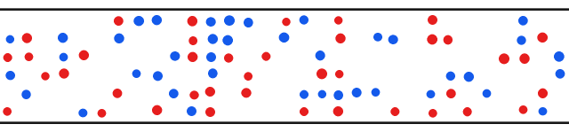

`envs.CounterFlow` has two groups of pedestrians that walk in opposite
directions along a corridor, which is periodic along its length. The forces
are those of the [evacuation environment](environments.md#room-evacuation).
Agents choose their desired direction; the other pedestrians want to walk
straight on.

```python
env = envs.CounterFlow(length=30.0, width=6.0, n_agents=4, n_crowd=76)
obs, state = env.reset(key)  # obs: (4, 33)
action = env.action_space.sample(key, (4,))  # a 2D vector per agent
obs, state, reward, terminated, truncated, info = env.step(key, state, action)
```

- **Observation and action** are given in the agent's own frame, in which it
  walks along +x; for the group that walks along -x all vectors are rotated
  by 180°. One policy can therefore serve both groups. An observation holds
  the lateral position, the velocity, and the relative position, relative
  velocity and group of the `n_neighbors` nearest pedestrians.
- **Reward**: the distance walked along the own direction in the step.
- `info["lane_order"]` measures the separation into lanes: for every
  pedestrian, with s pedestrians of its own group and o of the other group
  within one diameter of its lateral position, the mean of
  \(((s - o)/(s + o))^2\). It is 1 for perfect lanes.

Lanes of pedestrians who walk in the same direction form in simulations of
the social force model (Helbing and Molnár 1995). Here they form as well, with
the force law of Helbing et al. (2000) and without any agent: in the run of
the animation (80 pedestrians, 30 m × 6 m) the lane order rises from 0.08 to
0.95 in 30 s and to 1.00 in 60 s, and the mean speed along the walking
directions from 0.24 to 1.30 m/s, the desired speed. At a higher density
(`--pedestrians 120`) the same run forms no lanes within 90 s: the lane order
stays below 0.2 and the mean speed below 0.9 m/s. Whether agents can learn to
resolve this is one of the tasks for the trained policies.

## Brick wall

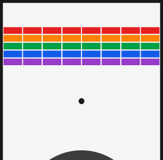

`envs.BrickWall` is an arcade game built from the physics core: a paddle
keeps a ball in play, and the ball knocks bricks out of a wall. The ball is a
particle that moves by Newton's equations and bounces off the walls, the
bricks and the paddle through a stiff elastic contact. The paddle is the cap
of a large disc, so the point where the ball hits it sets the direction of the
rebound. A brick disappears when the ball leaves it after a contact.

```python
env = envs.BrickWall(observation="pixels")  # or "state"
obs, state = env.reset(key)  # obs: (1, 84, 84, 2)
obs, state, reward, terminated, truncated, info = env.step(key, state, jnp.array([2]))
```

- **Observation**: `"state"` (ball position and velocity, paddle position,
  one entry per brick) or `"pixels"` (the current image and the one of the
  previous step, computed in JAX, so the game still compiles and batches).
  Pixel observations are slow for now: about 1,900 control steps per second
  for one game on a CPU, against 47,000 with state observations, and on a
  GPU the drawing code did not compile within 600 s (see the
  [roadmap](roadmap.md#performance-plan)).
- **Action**: stay, left or right; or the paddle velocity (`action="continuous"`).
- **Reward**: the number of bricks removed in the step. The game ends when
  the wall is cleared or the last of three balls is lost.

A hit by the moving paddle changes the speed of the ball; the speed then
relaxes to its nominal value without a change of direction
(`speed_relaxation`; 0 gives purely Newtonian motion). The scripted player
(`env.scripted_policy`) moves the paddle to where the ball will come down. In
the run of the animation it removes 14 of 40 bricks in 1000 steps; in the
test, eight games of 5000 steps all reach at least 39 bricks without losing
a ball.

## Billiards

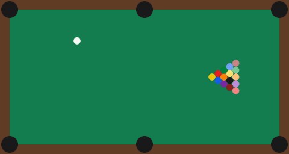

`envs.Billiards` is a table with six pockets, a cue ball and up to 15 object
balls. Balls slide with a constant friction and collide through damped
elastic contacts. An action is a shot: the direction and the speed of the cue
ball. One step simulates the shot until all balls are at rest.

```python
env = envs.Billiards()
obs, state = env.reset(key)  # obs: (1, 48)
action = jnp.array([[0.0, 1.0]])  # direction (angle / pi), strength
obs, state, reward, terminated, truncated, info = env.step(key, state, action)
```

- **Reward**: the number of object balls pocketed by the shot, and
  `scratch_penalty` (-1) if the cue ball is pocketed.
- The model has no spin: balls slide without rolling, and contacts act along
  the line of centres only. The parameters are plausible values, not
  measurements.

Tested mechanics (`tests/test_env_billiards.py`): the coefficient of
restitution of a head-on collision equals the set one (0.95) within 0.4 %,
and 0.7 within 2 %; after an elastic collision of equal balls the two
velocities are perpendicular; a ball stops after the distance \(v^2/(2a)\);
the cushions return the set fraction of the speed within 1 %. The simple
player (`env.aim_policy`) shoots at the object ball with the smallest cut
angle. In 16 games of 30 shots it pockets 14.5 of 15 balls on average (8 to
15), with 0.31 scratches per game; random shots pocket 1.06 balls.

## Herding

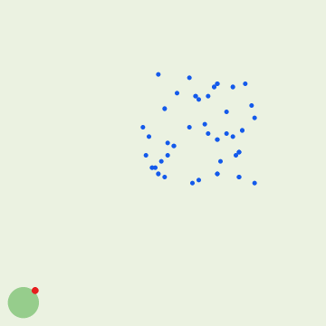

In `envs.Herding` the agents are shepherds that drive a flock to a target.
The flock rules are adapted from the model of Strömbom et al. (2014). A sheep
that sees a shepherd (within 65 m) takes the direction

\[
\mathbf d = h\,\hat{\mathbf d}_\text{previous} + c\,\hat{\mathbf C}
+ \rho_a \hat{\mathbf R}_a + \rho_s \hat{\mathbf R}_s + e\,\hat{\boldsymbol\epsilon},
\]

with unit vectors to the centre of its `n_neighbors` nearest sheep
(\(\hat{\mathbf C}\)), away from the sheep closer than \(r_a\) = 2 m
(\(\hat{\mathbf R}_a\)), away from the shepherds it sees
(\(\hat{\mathbf R}_s\)) and in a random direction; the weights are the
typical values of the paper, \(h = 0.5\), \(c = 1.05\), \(\rho_a = 2\),
\(\rho_s = 1\), \(e = 0.3\). A sheep that sees no shepherd grazes: it moves
in a random direction with a probability of 0.05 per step.

```python
env = envs.Herding(n_sheep=40, n_agents=1)
obs, state = env.reset(key)  # obs: (1, 11)
action = env.shepherd_policy(key, state, env.default_params)
obs, state, reward, terminated, truncated, info = env.step(key, state, action)
```

- **Reward**: the distance by which the centre of the flock has approached
  the target, and `success_reward` when the centre is within 10 m of it,
  which ends the episode.

Differences from the paper. The rules above give a *desired* velocity; the
motion follows from the physics core, in which sheep and shepherds are soft
discs whose velocity relaxes to the desired one in 0.25 s (the paper moves
points by fixed steps, without inertia or contacts). The equations of the
paper were not available in text form; the rules were taken from its text
and table of parameters. In the scripted shepherd, the driving position
\(r_a\sqrt N\) behind the flock is a choice made here, and the shepherd
slows down near a sheep instead of stopping. Results of the paper are
therefore not expected to be reproduced in numbers, and no comparison is
claimed.

The scripted shepherd (`env.shepherd_policy`) solves 16 of 16 games with 40
sheep, in 432 to 605 steps (mean 498); two shepherds need 453 to 702 steps
(mean 542). Shepherds that move at random solve none in 1000 steps. In the
animation the flock first runs away from the shepherd before it is collected.

## Microswimmer

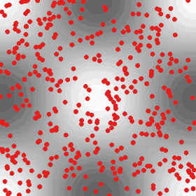

`envs.Microswimmer` is the task of Colabrese et al. (2017): a swimmer moves
at the speed \(v_s\) along its heading \(\mathbf p = (\cos\theta, \sin\theta)\)
in a Taylor–Green flow \(\mathbf u\) with the vorticity \(\omega\),

\[
\dot{\mathbf x} = \mathbf u + v_s \mathbf p + \sqrt{2 D_0}\,\boldsymbol\eta, \qquad
\dot\theta = \frac{\sin(\theta_k - \theta)}{2B} + \frac{\omega}{2} + \sqrt{2 D_R}\,\xi ,
\]

and the agent chooses the preferred direction \(\theta_k\): up, left, down or
right. The reward is the altitude gained. The two numbers of the paper are
\(\Phi = v_s/u_0\) and \(\Psi = B\omega_0\).

```python
env = envs.Microswimmer(n_agents=256, observation="discrete")
obs, state = env.reset(key)  # obs: (256,), one of 12 states
obs, state, reward, terminated, truncated, info = env.step(key, state, env.naive_policy())
```

- **Observation**: the vorticity and the heading, or (`"discrete"`) the 12
  coarse states of the paper: three levels of vorticity times four sectors
  of the heading.
- The swimmers do not interact: `n_agents` swimmers are independent copies
  of the task in one flow.

Tested (`tests/test_env_microswimmer.py`): in a still fluid the heading
follows the exact solution of the alignment equation; a passive particle
stays on its streamline and turns at half the vorticity.

Swimmers that always prefer "up" (naive gyrotaxis) are trapped by the
vortices at \(\Phi = 0.3\), \(\Psi = 1\), the point for which the paper shows
learning curves: their mean climbing speed is 0.0005 \(v_s\) (256 swimmers,
time 100 to 200). Fast swimmers climb freely (0.94 \(v_s\) at \(\Phi = 1\),
0.99 \(v_s\) at \(\Phi = 3\), both at \(\Psi = 1\)). This is the behaviour that
the paper describes in words; no numbers are compared. The animation shows
the trapped case.

Chosen here, because the supplementary material of the paper was not
available: the strength of the noise (\(D_R = 0.01\), \(D_0 = 0.001\)) and
the threshold of "vorticity close to zero" (a third of the maximum). The
reinforcement learning of the paper is not reproduced yet.

## Cell migration

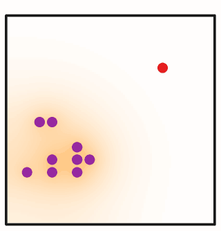

`envs.CellMigration` follows the model of neural crest cell migration of
Zhang, Chai, Sun and Lykotrafitis (2020). Cells are soft discs in a closed
square. An action is the direction of a cell's self-driven force. Leader
cells sense the direction to a source of chemoattractant and are rewarded for
reaching it quickly. All cells secrete a second chemoattractant, which
diffuses on a grid; cells are rewarded for moving up its gradient, which
keeps the group together (co-attraction). Cells repel each other on contact.

```python
env = envs.CellMigration(n_leaders=9)
obs, state = env.reset(key)  # obs: (9, 7)
action = env.gradient_policy(state, weight=0.5)
obs, state, reward, terminated, truncated, info = env.step(key, state, action)
```

- **Reward** of a cell: \(e^{-\beta^2} - 1\) for the angle \(\beta\) between
  its direction and the gradient of the secreted chemoattractant; leaders
  get this with the weight 0.3 and a step reward of -0.1 with the weight
  0.7, and nothing once they have arrived.

Taken from the paper: the region of 10 × 10, the cell diameter 0.5, the
contact force \(100\,e^{\text{overlap}/0.08}\), the viscous force
\(-(m/\tau)\mathbf v\) with \(\tau = 0.5\), the control interval 0.1, the
diffusion coefficient 1 on a grid of spacing 0.1, the observation, the action
and the rewards. Different, and chosen here: the self-driven force has a
constant magnitude; only the direction to the source is sensed; the second
chemoattractant is secreted at a constant rate and decays, so that the field
becomes steady; and the time step is 0.002, which the stiff contact needs.

With cells that follow the gradients (`env.gradient_policy`, 8 games of 9
leaders), all leaders reach the source. The weight of the co-attraction sets
how compact the group is on the way and how long it takes:

| Weight | Steps until all leaders arrived (min / mean / max) | Distance to the source at step 100 | Spread of the group at step 100 |
|---|---|---|---|
| 0 | 177 / 207 / 236 | 3.46 | 1.01 |
| 0.3 | 154 / 182 / 204 | 3.62 | 0.98 |
| 0.5 | 260 / 301 / 341 | 4.65 | 0.69 |

A strong co-attraction slows the group down, as the paper reports. No
agreement with the numbers of the paper is claimed: the source, the start
and the speed differ.

!!! warning "Followers"
    With `n_followers > 0` and the gradient policy, the followers form their
    own cluster and drift to a wall; they do not follow the leaders as in
    the paper. A cell senses its own secretion reflected by the walls, which
    draws it to a wall; whether this is the only cause has not been
    established. The default is therefore leaders only.

## Orbit transfer

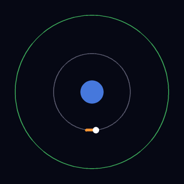

`envs.OrbitTransfer` is a task of orbital mechanics with a known optimum. A
spacecraft circles a planet on the orbit of radius 1 and must reach the
circular orbit of radius r1 (`target_radius`, default 2) with a thruster of
limited acceleration (`max_thrust` = 0.5), spending as little velocity
change \(\Delta v\), that is fuel, as possible. The units are \(GM = 1\) and
the radius of the first orbit, so the speed on it is 1 and its period
\(2\pi\). The planet and the spacecraft move under
[Newtonian gravity](physics.md#newtonian-gravity); the spacecraft are test
particles, so that several of them (`n_agents`) are independent copies of
the task, simulated together.

```python
env = envs.OrbitTransfer(n_agents=1, action="continuous")  # or "discrete"
params = env.default_params._replace(target_radius=3.0)
obs, state = env.reset(key, params)
action = env.hohmann_policy(state, params)  # the baseline
```

- **Action**: a thrust in the orbital frame of the spacecraft (radially out,
  and along the motion). Continuous: a vector whose length, capped at 1,
  scales the largest thrust. Discrete: one of nine, to coast or to thrust in
  one of the four directions at full thrust or at a tenth of it. The thrust
  is applied as half kicks before and after each velocity Verlet step (10
  steps of 0.01 per control step), which keeps the integration of second
  order.
- **Observation** (5 numbers): the distance from the planet, the radial and
  the transverse velocity, the target radius and the fuel left. They do not
  depend on where on its orbit the spacecraft is.
- **Reward**: minus the \(\Delta v\) spent in the step, and 1 on arrival.
- **End**: the spacecraft arrives when the semi-major axis of its orbit is
  within 2 % of r1 and the eccentricity below 0.02. It crashes closer than
  0.3 to the centre of the planet and escapes beyond 10. The fuel allows a
  \(\Delta v\) of 1 in all; an episode is truncated after 400 control steps
  (40 time units).

For impulsive burns the optimum is the Hohmann transfer: a prograde burn onto
the ellipse that touches both orbits, half a revolution, and a second
prograde burn at the far end of the ellipse, the apoapsis. Its \(\Delta v\)
is 0.2845 for r1 = 2. `env.hohmann_policy` flies it in closed loop. It burns
prograde until the apoapsis is at r1 and coasts; it starts the second burn
half the duration of that burn before the apoapsis, which it finds from
Kepler's equation, so that the burn is centred on the apoapsis, and burns
until the orbit is circular. With discrete actions it uses only the two
prograde thrusts. From `benchmarks/baselines.py`:

| Actions | r1 | Arrival (control step) | \(\Delta v\) | Hohmann \(\Delta v\) | Ratio |
|---|---|---|---|---|---|
| continuous | 1.5 | 46 | 0.1818 | 0.1816 | 1.001 |
| continuous | 2 | 61 | 0.2849 | 0.2845 | 1.002 |
| continuous | 3 | 94 | 0.3945 | 0.3938 | 1.002 |
| continuous | 4 | 130 | 0.4498 | 0.4487 | 1.002 |
| discrete | 1.5 | 55 | 0.1800 | 0.1816 | 0.991 |
| discrete | 2 | 67 | 0.2800 | 0.2845 | 0.984 |
| discrete | 3 | 101 | 0.3950 | 0.3938 | 1.003 |
| discrete | 4 | 140 | 0.4500 | 0.4487 | 1.003 |

Burns of finite thrust need a little more than the impulsive optimum. The
discrete controller can arrive with less, because the episode ends as soon
as the orbit is within the tolerances, before the steps of a tenth of the
thrust have made it exactly circular at r1. Random actions use up the fuel
and reach the orbit in none of 16 games, with either kind of action. No
policy has been trained on this task yet.

## Ring road

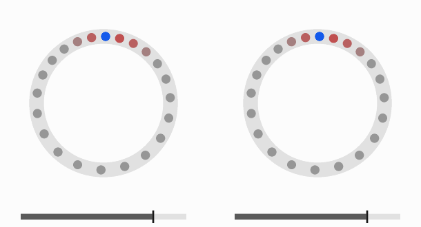

`envs.RingRoad` is the experiment of Sugiyama et al. (2008) with automated
vehicles. 22 vehicles drive in one lane of a ring road of 230 m. The human
drivers follow the
[intelligent driver model](physics.md#traffic-on-a-ring-road) with random
fluctuations of their acceleration (`noise` = 0.2 \(\mathrm{m\,s^{-3/2}}\): in a time
\(\Delta t\) a speed changes by an extra 0.2 \(\sqrt{\Delta t}\) times a
standard normal number). At this density uniform flow is unstable. The
fluctuations grow into a stop-and-go wave that travels backward around the
ring at 4.3 m/s (15.5 km/h, measured in
`test_a_phantom_jam_forms_and_moves_backward`), and the vehicles in the wave
come to a standstill. Sugiyama et al. observed such a jam form without any
bottleneck and found that it moved backward at the speed of jams on
highways. Some vehicles are automated (`n_agents`, default 1), as in the
mixed-autonomy ring of the Flow framework (Wu et al. 2022) and in the field
experiment of Stern et al. (2018), in which one automated vehicle dissipated
the waves of more than 20 human drivers.

```python
env = envs.RingRoad(n_agents=1, action="continuous")  # or "discrete"
params = env.default_params._replace(ring_length=260.0)
obs, state = env.reset(key, params)
action = env.smoothing_policy(state, params)  # the baseline
```

- **Action**: the acceleration of an automated vehicle, between −1 and
  1 m/s² (`max_accel`); with discrete actions one of nine levels from
  −1 to 1 m/s². With `safe=True`, the default, the vehicle never accelerates
  more than a human driver would in its place, which prevents collisions.
- **Observation** (3 numbers): its speed, the speed of the vehicle ahead and
  the gap to it.
- **Reward**: the distance that the vehicles have driven in the step,
  averaged over all vehicles; every agent receives the same. The return is
  the mean distance driven in the episode, which the stop-and-go wave
  reduces.
- **Start and end**: an episode starts in a stop-and-go wave. The gaps vary
  around the ring as a cosine of relative amplitude `wave` = 0.5 with a
  random phase, and every vehicle drives at the speed of uniform flow at its
  gap. It lasts 600 control steps of 0.5 s (300 s), each of five physics
  steps. A collision, possible only with `safe=False`, ends it.

Starting from a wave, instead of a simulated warm-up, keeps `reset` cheap:
the PPO baseline and the vectorised Gymnasium wrapper call it at every step.

Two scripted policies serve as baselines. `idm_policy` asks for the
acceleration of a human driver, without the fluctuations, once per control
step: the reference without control.
`smoothing_policy` cruises gently at 90 % of the speed of uniform flow, which
it computes from the ring length and the number of vehicles, and accelerates
with 0.1 per second times the difference. It leaves the jam slowly and opens
a gap to the vehicle ahead, which absorbs the next wave. From
`benchmarks/baselines.py`, with continuous actions and 32 games each:

| Ring length | Uniform flow | Return, like a human | Return, cruising gently | Gain | Speed spread |
|---|---|---|---|---|---|
| 220 m | 3.00 m/s | 644 m | 777 m | +21 % | 2.65 → 0.32 m/s |
| 230 m | 3.45 m/s | 737 m | 900 m | +22 % | 2.89 → 0.30 m/s |
| 250 m | 4.36 m/s | 921 m | 1142 m | +24 % | 3.34 → 0.29 m/s |
| 270 m | 5.27 m/s | 1108 m | 1384 m | +25 % | 3.73 → 0.28 m/s |

The speed spread is the standard deviation of the speeds of all vehicles,
averaged over the last 150 s. With discrete actions the gain is 16 to 22 %.
At 230 m every one of the 32 games gained between 17 and 26 %, and the
spread fell below 0.6 m/s after 42 s in the median game and after 100 s at
the latest. In trials during development, a vehicle that cruised at the full
speed of uniform flow, or that accelerated three times as fast, ran into the
back of the jam and did not dissolve it. Random actions also reduce the
spread, to about 0.9 m/s, but only by holding up all vehicles: the return
falls by more than a third. No policy has been trained on this task yet; the
baseline drives 10 % below the speed of uniform flow, which leaves room for a
better one.

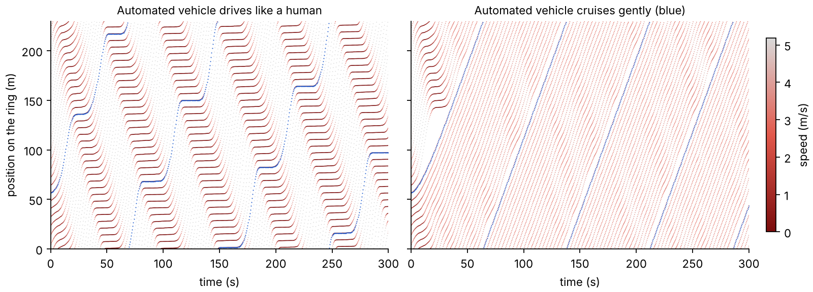

The trajectories of the two runs of the animation. Left: the jam is the dark
band of standing vehicles that moves backward, against the traffic; the
automated vehicle (blue) stops in it like everybody else. Right: the
automated vehicle leaves the first jam slowly, the white region ahead of it
is the gap it opens, and after about 40 s all vehicles drive at the same
speed.

## Soft walker

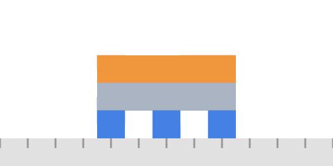

`envs.SoftWalker` is a robot made of 13 soft
[voxels](physics.md#soft-bodies-of-voxels) that has to learn to walk: a
trunk of five horizontal actuators (orange), a soft layer (grey) and three
legs of vertical actuators (blue), 24 point masses joined by damped springs.
The robot stands on the ground under gravity, and the ground holds its feet
by Coulomb friction. The units are the voxel size, the mass of a voxel and
the gravitational acceleration: for voxels of 10 cm the time unit is 0.1 s.

```python
env = envs.SoftWalker()  # or envs.SoftWalker(layout=("HHHH", "SSSS", "V..V"))
params = env.default_params._replace(friction=0.5)
obs, state = env.reset(key, params)
action = env.gait_policy(state, params)  # the baseline
```

- **Action**: one command in [−1, 1] for each of the 8 actuators. An
  actuator lengthens or shortens by up to 25 % (`strength`) along its
  direction. Its activation follows the command with a delay of 0.2 time
  units (`activation_time`), as a muscle does, so that a command cannot
  throw the robot.
- **Observation** (107 numbers): the velocity and the height of the centre
  of mass, the positions and velocities of the 24 corners relative to it,
  and the 8 activations.
- **Reward**: the distance that the centre of mass moves to the right in
  the step.
- **Episode**: 500 control steps of 0.1 time units; nothing ends it early.
  Each control step has 20 velocity Verlet steps.

The springs (stiffness 200 in these units, three times that in rigid
voxels) are damped by dashpots with a damping ratio of about 0.5; the ground
has the stiffness 3000 and the friction coefficient 1 (`friction`, an
episode parameter). The baseline `gait_policy` is open-loop: actuator \(i\)
in column \(x_i\) receives \(\sin 2\pi(t/T - x_i/\lambda)\), a wave of
contraction that runs forward along the body, with the period \(T\) = 1 and
the wavelength \(\lambda\) = 8 voxels. These values were chosen by a search
over periods and wavelengths during development. From
`benchmarks/baselines.py`, eight episodes each, distance in voxels per
episode:

| Friction | Gait | Random commands | No commands |
|---|---|---|---|
| 0.5 | 41.7 (38.8 to 44.7) | 0.6 (−2.1 to 2.6) | 0.0 |
| 1 | 39.1 (29.8 to 42.1) | 0.6 (−1.4 to 2.2) | 0.0 |
| 1.5 | 37.1 (36.5 to 38.0) | 1.0 (−0.1 to 3.6) | 0.0 |

The walk is chaotic: moving one corner by \(10^{-12}\) of a voxel at the
start changes the distance after 50 time units by about 10 %. The corners
therefore start with random displacements of up to 0.001 voxels, and the
table gives the mean and the range over the episodes. On frictionless ground
the same gait does not move the centre of mass at all. No policy has been
trained on this task yet.

## Demixing of two fluids

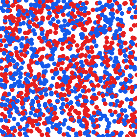

Not an environment, but a demonstration of the
[dissipative particle dynamics](physics.md#dissipative-particle-dynamics) in
the physics core: 1200 particles of two species in a periodic square, with
the repulsion a = 25 between like and a = 60 between unlike particles. The
fraction of neighbour pairs of the same species rises from 0.50 to 0.90 in 12
time units and to 0.95 in 60. The simulation starts from random positions,
which heats the fluid at first: the kinetic temperature without the flow
that the growing domains drive is 1.25 in the first 12 time units and 1.01
afterwards (set: 1).

## Galaxy encounter

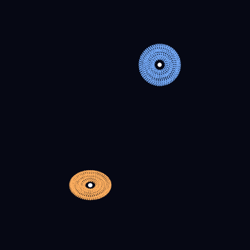

Not an environment either, but a demonstration of
[Newtonian gravity](physics.md#newtonian-gravity) in 3D, with the
restricted three-body model of Toomre & Toomre (1972). Each galaxy is a point
mass (\(GM = 1\)) at the centre of a disc of stars on circular orbits, and the
4948 stars are test particles that feel the two centres but not each other
(`NewtonGravity(softening=0.05, sources=2)`). The two centres approach on a
parabola with a closest distance of 1. Both discs turn in the sense of the
orbit; the first (blue) lies in the plane of the orbit, the second (orange)
is tilted by 45°. The picture is the projection on the plane of the orbit.
The passage draws a bridge of stars from each disc towards the other galaxy
and a tail on the far side.

In the simulation the centres come as close as 1.0012: the softening weakens
their attraction a little. At the end, 5 time units after the closest
approach, the stars are counted by the centre to which they are bound, that
is, relative to which alone their energy is negative:

| Stars of | Bound to their own centre | Captured by the other | Bound to neither |
|---|---|---|---|
| the flat disc | 74.1 % | 21.8 % | 4.2 % |
| the tilted disc | 84.7 % | 12.8 % | 2.5 % |

The flat disc loses more stars. Its stars move in the plane of the orbit and
in the same sense as the other galaxy, so they stay in step with its tidal
pull for longer.

## References

- J. S. Bhatia, H. Jackson, Y. Tian, J. Xu and W. Matusik, Evolution Gym: A
  large-scale benchmark for evolving soft robots, Advances in Neural
  Information Processing Systems 34 (2021).
- S. Colabrese, K. Gustavsson, A. Celani and L. Biferale, Flow navigation by
  smart microswimmers via reinforcement learning, Phys. Rev. Lett. 118,
  158004 (2017).
- D. Helbing and P. Molnár, Social force model for pedestrian dynamics, Phys.
  Rev. E 51, 4282 (1995).
- D. Helbing, I. Farkas and T. Vicsek, Simulating dynamical features of
  escape panic, Nature 407, 487 (2000).
- W. Hohmann, Die Erreichbarkeit der Himmelskörper, Oldenbourg, Munich
  (1925).
- R. E. Stern, S. Cui, M. L. Delle Monache, R. Bhadani, M. Bunting, M.
  Churchill, N. Hamilton, R. Haulcy, H. Pohlmann, F. Wu, B. Piccoli, B.
  Seibold, J. Sprinkle and D. B. Work, Dissipation of stop-and-go waves via
  control of autonomous vehicles: Field experiments, Transp. Res. C 89, 205
  (2018).
- D. Strömbom, R. P. Mann, A. M. Wilson, S. Hailes, A. J. Morton, D. J. T.
  Sumpter and A. J. King, Solving the shepherding problem: heuristics for
  herding autonomous, interacting agents, J. R. Soc. Interface 11, 20140719
  (2014).
- Y. Sugiyama, M. Fukui, M. Kikuchi, K. Hasebe, A. Nakayama, K. Nishinari,
  S. Tadaki and S. Yukawa, Traffic jams without bottlenecks: experimental
  evidence for the physical mechanism of the formation of a jam, New J.
  Phys. 10, 033001 (2008).
- A. Toomre and J. Toomre, Galactic bridges and tails, Astrophys. J. 178, 623
  (1972).
- M. Treiber, A. Hennecke and D. Helbing, Congested traffic states in
  empirical observations and microscopic simulations, Phys. Rev. E 62, 1805
  (2000).
- C. Wu, A. R. Kreidieh, K. Parvate, E. Vinitsky and A. M. Bayen, Flow: A
  modular learning framework for mixed autonomy traffic, IEEE Trans. Robot.
  38, 1270 (2022).
- Y. Zhang, Z. Chai, Y. Sun and G. Lykotrafitis, A deep reinforcement
  learning model based on deterministic policy gradient for collective
  neural crest cell migration, arXiv:2007.03190 (2020).
