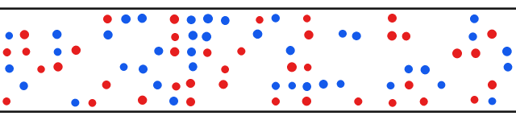
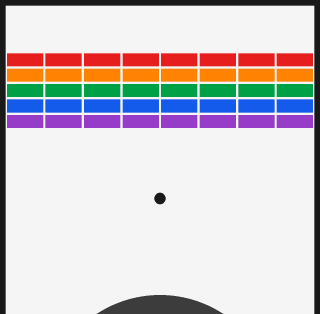
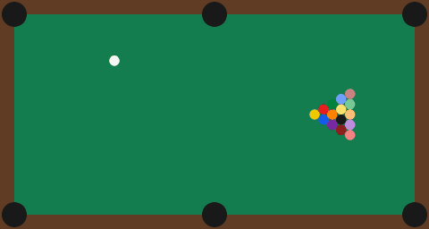
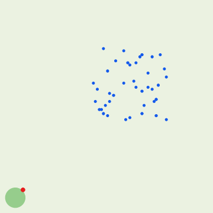
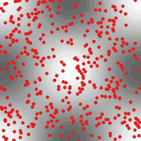
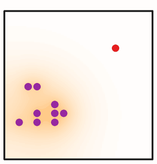
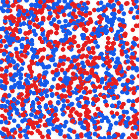

# Experimental environments

These environments show what the physics core can do beyond room evacuation.
They share the [interface](environments.md#interface) of all environments and
have tests for their mechanics, but none of them has been compared with
measurements or reproduces a published result in numbers. Where a model is
taken from a paper, this page states what was taken and what differs.

The numbers on this page are printed by the scripts in
[`examples/gallery`](https://github.com/ZhaojieC/particlegym/tree/main/examples/gallery)
and by
[`benchmarks/baselines.py`](https://github.com/ZhaojieC/particlegym/blob/main/benchmarks/baselines.py)
(reference output: `benchmarks/baselines.txt`), with fixed random seeds. The
policies are scripted; no learning is involved yet.

## Counter-flow in a corridor



`envs.CounterFlow` has two groups of pedestrians that walk in opposite
directions along a corridor, which is periodic along its length. The forces
are those of the [evacuation environment](environments.md#room-evacuation).
Agents choose their desired direction; the other pedestrians want to walk
straight on.

```python
env = envs.CounterFlow(length=30.0, width=6.0, n_agents=4, n_crowd=76)
obs, state = env.reset(key)  # obs: (4, 33)
action = env.action_space.sample(key, (4,))  # a 2D vector per agent
obs, state, reward, terminated, truncated, info = env.step(key, state, action)
```

- **Observation and action** are given in the agent's own frame, in which it
  walks along +x; for the group that walks along -x all vectors are rotated
  by 180°. One policy can therefore serve both groups. An observation holds
  the lateral position, the velocity, and the relative position, relative
  velocity and group of the `n_neighbors` nearest pedestrians.
- **Reward**: the distance walked along the own direction in the step.
- `info["lane_order"]` measures the separation into lanes: for every
  pedestrian, with s pedestrians of its own group and o of the other group
  within one diameter of its lateral position, the mean of
  \(((s - o)/(s + o))^2\). It is 1 for perfect lanes.

Lanes of pedestrians who walk in the same direction form in simulations of
the social force model (Helbing and Molnár 1995). Here they form as well, with
the force law of Helbing et al. (2000) and without any agent: in the run of
the animation (80 pedestrians, 30 m × 6 m) the lane order rises from 0.08 to
0.95 in 30 s and to 1.00 in 60 s, and the mean speed along the walking
directions from 0.24 to 1.30 m/s, the desired speed. At a higher density
(`--pedestrians 120`) the same run forms no lanes within 90 s: the lane order
stays below 0.2 and the mean speed below 0.9 m/s. Whether agents can learn to
resolve this is one of the tasks for the trained policies.

## Brick wall



`envs.BrickWall` is an arcade game built from the physics core: a paddle
keeps a ball in play, and the ball knocks bricks out of a wall. The ball is a
particle that moves by Newton's equations and bounces off the walls, the
bricks and the paddle through a stiff elastic contact. The paddle is the cap
of a large disc, so the point where the ball hits it sets the direction of the
rebound. A brick disappears when the ball leaves it after a contact.

```python
env = envs.BrickWall(observation="pixels")  # or "state"
obs, state = env.reset(key)  # obs: (1, 84, 84, 2)
obs, state, reward, terminated, truncated, info = env.step(key, state, jnp.array([2]))
```

- **Observation**: `"state"` (ball position and velocity, paddle position,
  one entry per brick) or `"pixels"` (the current image and the one of the
  previous step, computed in JAX, so the game still compiles and batches).
  Pixel observations cost about three times as much as state observations
  for one game on a CPU, and they run on a GPU (see the
  [roadmap](roadmap.md#performance-plan)); the bricks are drawn from a table
  of the bricks that can cover each pixel.
- **Action**: stay, left or right; or the paddle velocity (`action="continuous"`).
- **Reward**: the number of bricks removed in the step. The game ends when
  the wall is cleared or the last of three balls is lost.

A hit by the moving paddle changes the speed of the ball; the speed then
relaxes to its nominal value without a change of direction
(`speed_relaxation`; 0 gives purely Newtonian motion). The scripted player
(`env.scripted_policy`) moves the paddle to where the ball will come down. In
the run of the animation it removes 14 of 40 bricks in 1000 steps; in the
test, eight games of 5000 steps all reach at least 39 bricks without losing
a ball.

## Billiards



`envs.Billiards` is a table with six pockets, a cue ball and up to 15 object
balls. Balls slide with a constant friction and collide through damped
elastic contacts. An action is a shot: the direction and the speed of the cue
ball. One step simulates the shot until all balls are at rest.

```python
env = envs.Billiards()
obs, state = env.reset(key)  # obs: (1, 48)
action = jnp.array([[0.0, 1.0]])  # direction (angle / pi), strength
obs, state, reward, terminated, truncated, info = env.step(key, state, action)
```

- **Reward**: the number of object balls pocketed by the shot, and
  `scratch_penalty` (-1) if the cue ball is pocketed.
- The model has no spin: balls slide without rolling, and contacts act along
  the line of centres only. The parameters are plausible values, not
  measurements.

Tested mechanics (`tests/test_env_billiards.py`): the coefficient of
restitution of a head-on collision equals the set one (0.95) within 0.4 %,
and 0.7 within 2 %; after an elastic collision of equal balls the two
velocities are perpendicular; a ball stops after the distance \(v^2/(2a)\);
the cushions return the set fraction of the speed within 1 %. The simple
player (`env.aim_policy`) shoots at the object ball with the smallest cut
angle. In 16 games of 30 shots it pockets 14.5 of 15 balls on average (8 to
15), with 0.31 scratches per game; random shots pocket 1.06 balls.

## Herding



In `envs.Herding` the agents are shepherds that drive a flock to a target.
The flock rules are adapted from the model of Strömbom et al. (2014). A sheep
that sees a shepherd (within 65 m) takes the direction

\[
\mathbf d = h\,\hat{\mathbf d}_\text{previous} + c\,\hat{\mathbf C}
+ \rho_a \hat{\mathbf R}_a + \rho_s \hat{\mathbf R}_s + e\,\hat{\boldsymbol\epsilon},
\]

with unit vectors to the centre of its `n_neighbors` nearest sheep
(\(\hat{\mathbf C}\)), away from the sheep closer than \(r_a\) = 2 m
(\(\hat{\mathbf R}_a\)), away from the shepherds it sees
(\(\hat{\mathbf R}_s\)) and in a random direction; the weights are the
typical values of the paper, \(h = 0.5\), \(c = 1.05\), \(\rho_a = 2\),
\(\rho_s = 1\), \(e = 0.3\). A sheep that sees no shepherd grazes: it moves
in a random direction with a probability of 0.05 per step.

```python
env = envs.Herding(n_sheep=40, n_agents=1)
obs, state = env.reset(key)  # obs: (1, 11)
action = env.shepherd_policy(key, state, env.default_params)
obs, state, reward, terminated, truncated, info = env.step(key, state, action)
```

- **Reward**: the distance by which the centre of the flock has approached
  the target, and `success_reward` when the centre is within 10 m of it,
  which ends the episode.

Differences from the paper. The rules above give a *desired* velocity; the
motion follows from the physics core, in which sheep and shepherds are soft
discs whose velocity relaxes to the desired one in 0.25 s (the paper moves
points by fixed steps, without inertia or contacts). The equations of the
paper were not available in text form; the rules were taken from its text
and table of parameters. In the scripted shepherd, the driving position
\(r_a\sqrt N\) behind the flock is a choice made here, and the shepherd
slows down near a sheep instead of stopping. Results of the paper are
therefore not expected to be reproduced in numbers, and no comparison is
claimed.

The scripted shepherd (`env.shepherd_policy`) solves 16 of 16 games with 40
sheep, in 432 to 605 steps (mean 498); two shepherds need 453 to 702 steps
(mean 542). Shepherds that move at random solve none in 1000 steps. In the
animation the flock first runs away from the shepherd before it is collected.

## Microswimmer



`envs.Microswimmer` is the task of Colabrese et al. (2017): a swimmer moves
at the speed \(v_s\) along its heading \(\mathbf p = (\cos\theta, \sin\theta)\)
in a Taylor–Green flow \(\mathbf u\) with the vorticity \(\omega\),

\[
\dot{\mathbf x} = \mathbf u + v_s \mathbf p + \sqrt{2 D_0}\,\boldsymbol\eta, \qquad
\dot\theta = \frac{\sin(\theta_k - \theta)}{2B} + \frac{\omega}{2} + \sqrt{2 D_R}\,\xi ,
\]

and the agent chooses the preferred direction \(\theta_k\): up, left, down or
right. The reward is the altitude gained. The two numbers of the paper are
\(\Phi = v_s/u_0\) and \(\Psi = B\omega_0\).

```python
env = envs.Microswimmer(n_agents=256, observation="discrete")
obs, state = env.reset(key)  # obs: (256,), one of 12 states
obs, state, reward, terminated, truncated, info = env.step(key, state, env.naive_policy())
```

- **Observation**: the vorticity and the heading, or (`"discrete"`) the 12
  coarse states of the paper: three levels of vorticity times four sectors
  of the heading.
- The swimmers do not interact: `n_agents` swimmers are independent copies
  of the task in one flow.

Tested (`tests/test_env_microswimmer.py`): in a still fluid the heading
follows the exact solution of the alignment equation; a passive particle
stays on its streamline and turns at half the vorticity.

Swimmers that always prefer "up" (naive gyrotaxis) are trapped by the
vortices at \(\Phi = 0.3\), \(\Psi = 1\), the point for which the paper shows
learning curves: their mean climbing speed is 0.0005 \(v_s\) (256 swimmers,
time 100 to 200). Fast swimmers climb freely (0.94 \(v_s\) at \(\Phi = 1\),
0.99 \(v_s\) at \(\Phi = 3\), both at \(\Psi = 1\)). This is the behaviour that
the paper describes in words; no numbers are compared. The animation shows
the trapped case.

Chosen here, because the supplementary material of the paper was not
available: the strength of the noise (\(D_R = 0.01\), \(D_0 = 0.001\)) and
the threshold of "vorticity close to zero" (a third of the maximum). The
reinforcement learning of the paper is not reproduced yet.

## Cell migration



`envs.CellMigration` follows the model of neural crest cell migration of
Zhang, Chai, Sun and Lykotrafitis (2020). Cells are soft discs in a closed
square. An action is the direction of a cell's self-driven force. Leader
cells sense the direction to a source of chemoattractant and are rewarded for
reaching it quickly. All cells secrete a second chemoattractant, which
diffuses on a grid; cells are rewarded for moving up its gradient, which
keeps the group together (co-attraction). Cells repel each other on contact.

```python
env = envs.CellMigration(n_leaders=9)
obs, state = env.reset(key)  # obs: (9, 7)
action = env.gradient_policy(state, weight=0.5)
obs, state, reward, terminated, truncated, info = env.step(key, state, action)
```

- **Reward** of a cell: \(e^{-\beta^2} - 1\) for the angle \(\beta\) between
  its direction and the gradient of the secreted chemoattractant; leaders
  get this with the weight 0.3 and a step reward of -0.1 with the weight
  0.7, and nothing once they have arrived.

Taken from the paper: the region of 10 × 10, the cell diameter 0.5, the
contact force \(100\,e^{\text{overlap}/0.08}\), the viscous force
\(-(m/\tau)\mathbf v\) with \(\tau = 0.5\), the control interval 0.1, the
diffusion coefficient 1 on a grid of spacing 0.1, the observation, the action
and the rewards. Different, and chosen here: the self-driven force has a
constant magnitude; only the direction to the source is sensed; the second
chemoattractant is secreted at a constant rate and decays, so that the field
becomes steady; and the time step is 0.002, which the stiff contact needs.

With cells that follow the gradients (`env.gradient_policy`, 8 games of 9
leaders), all leaders reach the source. The weight of the co-attraction sets
how compact the group is on the way and how long it takes:

| Weight | Steps until all leaders arrived (min / mean / max) | Distance to the source at step 100 | Spread of the group at step 100 |
|---|---|---|---|
| 0 | 177 / 207 / 236 | 3.46 | 1.01 |
| 0.3 | 154 / 182 / 204 | 3.62 | 0.98 |
| 0.5 | 260 / 301 / 341 | 4.65 | 0.69 |

A strong co-attraction slows the group down, as the paper reports. No
agreement with the numbers of the paper is claimed: the source, the start
and the speed differ.

!!! warning "Followers"
    With `n_followers > 0` and the gradient policy, the followers form their
    own cluster and drift to a wall; they do not follow the leaders as in
    the paper. A cell senses its own secretion reflected by the walls, which
    draws it to a wall; whether this is the only cause has not been
    established. The default is therefore leaders only.

## Demixing of two fluids



Not an environment, but a demonstration of the
[dissipative particle dynamics](physics.md#dissipative-particle-dynamics) in
the physics core: 1200 particles of two species in a periodic square, with
the repulsion a = 25 between like and a = 60 between unlike particles. The
fraction of neighbour pairs of the same species rises from 0.50 to 0.90 in 12
time units and to 0.95 in 60. The simulation starts from random positions,
which heats the fluid at first: the kinetic temperature without the flow
that the growing domains drive is 1.25 in the first 12 time units and 1.01
afterwards (set: 1).

## References

- S. Colabrese, K. Gustavsson, A. Celani and L. Biferale, Flow navigation by
  smart microswimmers via reinforcement learning, Phys. Rev. Lett. 118,
  158004 (2017).
- D. Helbing and P. Molnár, Social force model for pedestrian dynamics, Phys.
  Rev. E 51, 4282 (1995).
- D. Helbing, I. Farkas and T. Vicsek, Simulating dynamical features of
  escape panic, Nature 407, 487 (2000).
- D. Strömbom, R. P. Mann, A. M. Wilson, S. Hailes, A. J. Morton, D. J. T.
  Sumpter and A. J. King, Solving the shepherding problem: heuristics for
  herding autonomous, interacting agents, J. R. Soc. Interface 11, 20140719
  (2014).
- Y. Zhang, Z. Chai, Y. Sun and G. Lykotrafitis, A deep reinforcement
  learning model based on deterministic policy gradient for collective
  neural crest cell migration, arXiv:2007.03190 (2020).
