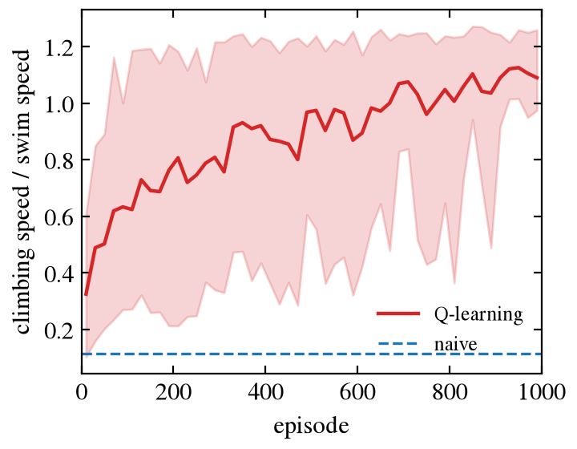
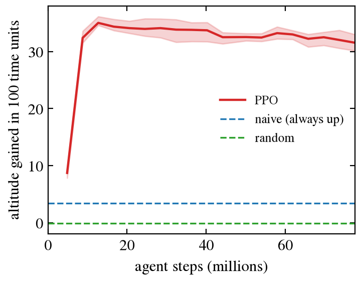
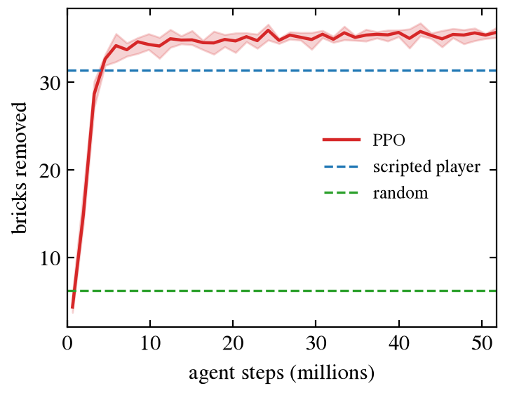
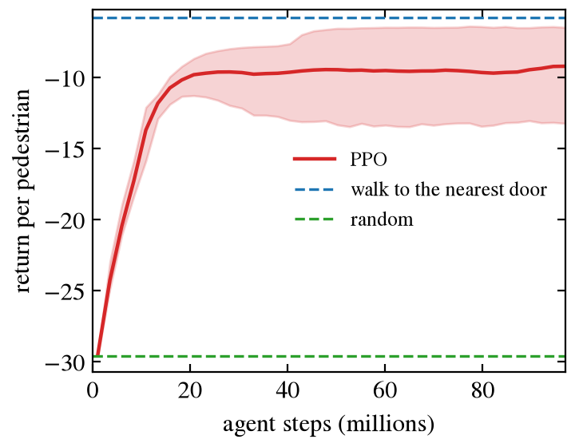
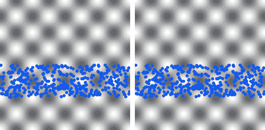
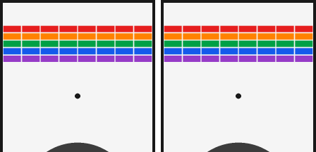
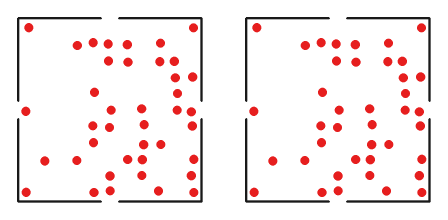
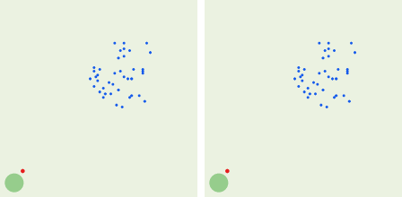

# Learning

This page describes the wrappers for the Gymnasium and PettingZoo interfaces,
two small learning baselines written in JAX, and what has been learned with
them so far. Everything here belongs to the development version of 0.2.

## Wrappers

The environments are pure functions (see
[Interface](environments.md#interface)). The wrappers give them the
interfaces that most learning libraries expect. They need the optional
dependencies: `pip install "particlegym[gymnasium,pettingzoo]"`.

```python
import gymnasium as gym

import particlegym.wrappers  # registers the environments below

env = gym.make("particlegym/BrickWall-v0", render_mode="rgb_array")
obs, info = env.reset(seed=0)
obs, reward, terminated, truncated, info = env.step(env.action_space.sample())
frame = env.render()
```

| Id | Environment |
|---|---|
| `particlegym/Evacuation2D-v0` | one pedestrian in a room of 10 m × 10 m with one door |
| `particlegym/BrickWall-v0` | [brick wall](experimental.md#brick-wall), state observations |
| `particlegym/Billiards-v0` | [billiards](experimental.md#billiards) |
| `particlegym/Herding-v0` | [herding](experimental.md#herding) with one shepherd |
| `particlegym/Microswimmer-v0` | one [microswimmer](experimental.md#microswimmer) |

Other single-agent environments, or other settings, are wrapped directly:

```python
from particlegym import envs
from particlegym.wrappers import GymnasiumEnv, GymnasiumVectorEnv, PettingZooEnv

env = GymnasiumEnv(envs.Billiards(n_balls=3))
many = GymnasiumVectorEnv(envs.Microswimmer(), num_envs=256)
crowd = PettingZooEnv(envs.CounterFlow(n_agents=8, n_crowd=72))
```

- `GymnasiumVectorEnv` steps all copies in one call with `jax.vmap`. A copy
  whose episode has ended is reset in the same step; its last observation is
  in `info["final_obs"]`.
- `PettingZooEnv` follows the parallel interface. The agents are named
  `agent_0`, `agent_1`, …; an agent whose episode has ended leaves
  `env.agents`.
- `render()` returns the picture of `particlegym.viz` as an array
  (`render_mode="rgb_array"`).
- The state of the functional environment is available as `env_state`.

The wrappers convert between JAX and NumPy arrays at every step. For training
in JAX, use the functional interface: the roll-outs then compile together
with the learner, as in the baselines below.

## Baselines

`particlegym.baselines` holds two learners. They are meant as reference
points and as examples of how to train on the functional interface, not as a
learning library. They need only JAX.

### PPO

`particlegym.baselines.ppo` implements proximal policy optimisation (Schulman
et al. 2017) with generalized advantage estimation (Schulman et al. 2016) in
one file.

```python
import jax

from particlegym import envs
from particlegym.baselines import ppo

env = envs.BrickWall()
config = ppo.PPOConfig(n_envs=1024, n_steps=128, n_iterations=400, gamma=0.995)
train = jax.jit(jax.vmap(lambda key: ppo.train(key, env, env.default_params, config)))
policies, curves = train(jax.random.split(jax.random.key(0), 5))  # five seeds at once
```

- All agents of an environment share one policy and learn from their own
  observations and rewards. There is no central critic.
- The policy and the value function are two small multilayer perceptrons.
  Discrete actions are drawn from a categorical distribution, continuous
  actions from a Gaussian whose width does not depend on the observation.
  Pixel observations are not supported.
- An episode that is cut off after `max_steps` is not treated as a failure:
  the value of the last observation stands for the rewards that would have
  followed. Agents that finish before the others (pedestrians that have left
  the room) no longer contribute to the update.
- `ppo.init` and `ppo.run` cut a run into pieces, to save policies in
  between; `ppo.act` gives the actions of a policy; `ppo.evaluate` plays
  complete episodes with any policy function; `ppo.save_policy` and
  `ppo.load_policy` store policies.

The results depend on the settings. On the cart-pole task below, settings
with few gradient steps per collected sample (large minibatches) left some
seeds well below the largest return in our trials.

### Tabular Q-learning

`particlegym.baselines.q_learning` is for environments with discrete
observations and actions. The table of an agent is updated when its observed
state changes, with the reward collected since the previous change, as in
the microswimmer study of Colabrese et al. (2017). The table starts with
large equal entries, so that every action is tried. Every agent learns its
own table.

### Checks

| Property | Test (`tests/test_baselines.py`) | Criterion | Reference result |
|---|---|---|---|
| Advantage estimates | `test_gae_matches_a_direct_sum` | equal to the discounted sum of the residuals, written as a loop, with terminated and truncated episodes | equal to 1e-6 |
| PPO learns a standard task | `test_ppo_learns_to_balance_the_pole` (cart-pole with the equations and limits of `CartPole-v1`, largest return 500; three seeds, 204,800 steps each) | return without exploration noise above 475 for every seed, averaged over 32 episodes | 500 for all three seeds; about 20 after the first update |
| Reproducible and divisible runs | `test_training_is_a_function_of_the_key_and_can_be_cut_into_pieces` | the same key gives the same policy; a run in two pieces equals the run in one | passes |
| Several agents, continuous actions | `test_ppo_runs_with_several_agents_that_finish_at_different_times`, `test_ppo_runs_with_continuous_actions_and_stores_its_policy` | finite policies and curves; actions within their bounds; a stored policy gives the same actions | passes |
| Q-learning finds known values | `test_q_learning_finds_the_values_of_a_small_problem` (four sites on a ring, a reward of 1 per step forwards, discount 0.9) | best action forwards everywhere; value \(1/(1-0.9) = 10\) within 0.1 % | 10.00001 |
| Q-learning on the microswimmer | `test_q_learning_swimmers_climb_faster_than_naive_swimmers` (16 learners, 200 episodes of 50 time units) | altitude gained in the last 50 episodes more than 1.3 times that of naive swimmers | 0.37 against 0.19, in units of the swim speed |

The wrappers are checked with the tools of the two libraries
(`tests/test_wrappers.py`): `gymnasium.utils.env_checker.check_env` for the
five registered ids, `pettingzoo.test.parallel_api_test` for the evacuation,
counter-flow, herding and cell-migration environments, and a comparison of a
wrapped episode with the functional environment.

## Smart microswimmers

Colabrese et al. (2017) showed that a swimmer which senses the vorticity and
its own heading can learn, by Q-learning, to climb through a flow in which a
swimmer that always steers upwards is trapped. The
[microswimmer environment](experimental.md#microswimmer) with discrete
observations has the 12 states and 4 actions of that study, and
`examples/learning/microswimmer_q.py` runs the learning at the swimming
number \(\Phi = 0.3\) and the stability number \(\Psi = 1\):

```bash
python examples/learning/microswimmer_q.py --output results
python examples/learning/plot.py --input results --output results
```

{ width="420" }

*Climbing speed during learning, in units of the swim speed: mean of 32
independent learners (line) and the range from the 10th to the 90th
percentile (band). Dashed: swimmers that always steer upwards.*

With 32 learners and 1000 episodes of 100 time units
(`benchmarks/learning/microswimmer_q_summary.txt`):

| | Climbing speed / swim speed |
|---|---|
| Learners, first 100 episodes | 0.51 (0.29 to 0.95 among the learners) |
| Learners, last 100 episodes | 1.11 (0.67 to 1.22) |
| Learned tables, best action, new starts | 1.10 |
| Naive swimmers, same starts | 0.11 |

The naive swimmers gain altitude only at the start, before the vortices trap
them; over long times their climbing speed is 0.0005
(`benchmarks/baselines.txt`). The learners end with a speed above 1: they
gain more altitude than their own swimming gives, because they stay where
the flow rises. This agrees with the paper in direction. The numbers are not
compared with it: the strength of the noise and the thresholds of the states
are in its supplementary material, which was not available, and the learning
rate and the discount factor were chosen here.

## Tasks for PPO

`examples/learning/train.py` trains five seeds at once on one of four tasks
and then lets the policies and the baselines play the same evaluation
episodes:

| Task | Environment | Compared with |
|---|---|---|
| `microswimmer` | 16 swimmers with continuous observations, \(\Phi = 0.3\), \(\Psi = 1\) | naive swimmers, random actions |
| `evacuation` | 40 pedestrians in the room with four doors of Zhang et al. (2021), at most 30 s | walking to the nearest door, random actions |
| `brick_wall` | the brick wall with three balls, at most 3000 steps | the scripted player, random actions |
| `herding` | one shepherd and 40 sheep, at most 1000 steps | the scripted shepherd, random actions |

```bash
python examples/learning/train.py --task brick_wall --output results
python examples/learning/plot.py --input results --output results
python examples/learning/animate.py --task brick_wall --input results
```

`train.py` writes the learning curves, the policies before and after
training and the returns of the evaluation episodes; `plot.py` draws the
curves with the baselines; `animate.py` shows the policy before and after
training side by side, for the seed with the median return; `doors.py`
counts the doors that the pedestrians of the evacuation task use.

## Results of PPO

One run of `train.py` per task with five seeds, on one NVIDIA L40S GPU
(JAX 0.11.2, single precision). The settings were fixed before the run and
were not tuned afterwards. The numbers are mean returns over 64 evaluation
episodes with the same starts for every policy; for PPO, the mean over the
five seeds and the range of the seeds. The outputs are in
`benchmarks/learning`.

| Task | PPO, best action | PPO with exploration noise | Scripted rule | Random actions |
|---|---|---|---|---|
| `microswimmer`: altitude gained in 100 time units | 39.8 (35.4 to 42.1) | 31.0 | 3.4 | −0.1 |
| `brick_wall`: bricks removed, of 40 | 33.6 (32.2 to 35.0) | 35.5 | 31.3 | 6.2 |
| `evacuation`: return per pedestrian | −8.9 (−12.8 to −6.4) | −9.2 | −5.8 | −29.6 |
| `herding`: return | −0.2 (−0.2 to −0.2) | −0.2 | 159.5 | −0.4 |

PPO learns two of the four tasks, is worse than a simple rule in the third
and fails in the fourth.

| Microswimmer | Brick wall | Evacuation |
|---|---|---|
|  |  |  |

*Return during training, with exploration noise, against the number of agent
steps of one seed: mean of the five seeds (line) and their range (band).
Dashed: the baselines.*

**Microswimmer.** With the continuous observation, all five seeds learn to
climb: 39.8 length units in 100 time units, 1.3 times the distance of 30
that a swimmer covers by its own swimming, against 3.4 for naive swimmers.
The return during training reaches 35 after 13 million agent steps and then
falls slowly to about 32; the best action of the final policy does better
than the policy with its exploration noise.



*400 swimmers steered by the policy before training (left) and after
training (right), from the same starts. The picture shows 4 × 4 periods of
the flow and the altitude that the swimmers have reached.*

**Brick wall.** All five seeds remove more bricks than the scripted player
in 3000 steps (60 s of play): 33.6 of 40 against 31.3. The return of the
scripted player varies between episodes with a standard deviation of 5.5,
and most episodes of both players last until the step limit. The trained
policies do a little better with their exploration noise (35.5) than with
the best action.



**Evacuation.** The return is −0.1 for every step of 0.1 s in the room, so
−8.9 means that a pedestrian needs 8.9 s on average to leave. The trained
policies empty the room before the limit of 30 s in all but one of their 320
evaluation episodes, but none is as fast as walking to the nearest door
(5.8 s), and the seeds differ. The policies do
not use all four doors (`benchmarks/learning/evacuation_doors.txt`): the
best seed uses three doors, two seeds use two, and the two worst seeds send
nearly everyone to one door. A pedestrian observes its own position and
velocity only, not the other pedestrians.



**Herding.** PPO does not learn this task. In all five seeds the trained
shepherd walks away from the flock, which stays where it is: the return is
−0.2, against 159.5 for the scripted shepherd of Strömbom et al. (2014),
which brings the flock to the target in 506 steps on average. The reward is
the distance by which the centre of the flock approaches the target, and the
shepherd starts on the side of the flock that faces the target, so its first
encounters probably push the flock the wrong way. Other rewards, a
curriculum or more exploration have not been tried.



*The trained shepherd (right) leaves the field.*

Training took 27 s (microswimmer), 43 s (brick wall), 45 s (evacuation) and
136 s (herding) for the five seeds together, compilation included. With the
78.6, 52.4, 98.3 and 39.3 million agent steps of each seed, this is 14.7,
6.1, 11.0 and 1.4 million agent steps per second, updates of the networks
included.

Limits of these results: one run per task; the policies see no pictures and
no other agents; the critic is not central; and the evacuation and herding
tasks are not solved.

## References

- S. Colabrese, K. Gustavsson, A. Celani and L. Biferale, Flow navigation by
  smart microswimmers via reinforcement learning, Phys. Rev. Lett. 118,
  158004 (2017).
- D. P. Kingma and J. Ba, Adam: a method for stochastic optimization,
  arXiv:1412.6980 (2014).
- J. Schulman, P. Moritz, S. Levine, M. Jordan and P. Abbeel,
  High-dimensional continuous control using generalized advantage estimation,
  arXiv:1506.02438 (2015).
- J. Schulman, F. Wolski, P. Dhariwal, A. Radford and O. Klimov, Proximal
  policy optimization algorithms, arXiv:1707.06347 (2017).
- Y. Zhang, Z. Chai and G. Lykotrafitis, Deep reinforcement learning with a
  particle dynamics environment applied to emergency evacuation of a room
  with obstacles, Physica A 571, 125845 (2021).
